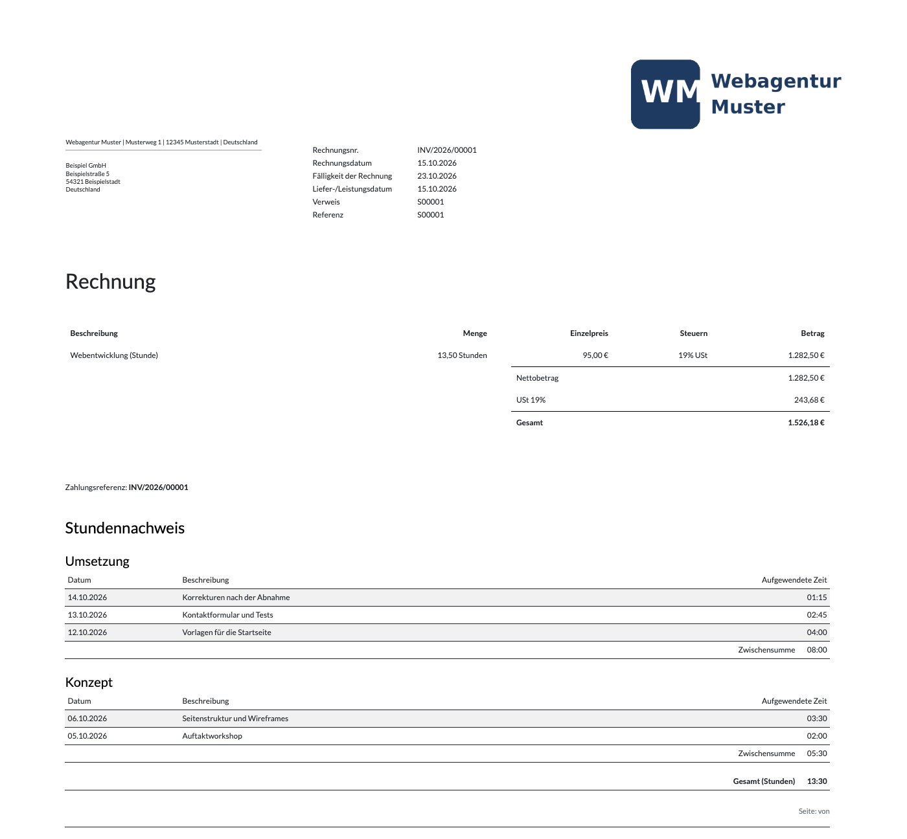
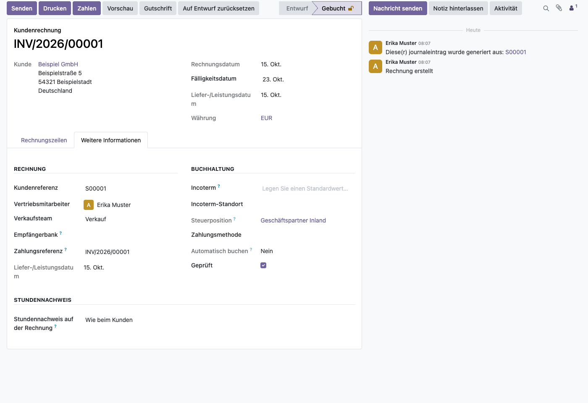

# Stundennachweis auf der Rechnung für Odoo
<!-- /!\ Non OCA Context : Set here the badge of your runbot / runboat instance. -->

<!-- /!\ Non OCA Context : Set here the badge of your translation instance. -->

<!-- /!\ do not modify above this line -->

Die abgerechneten Zeiteinträge stehen auf der Rechnung selbst, nach Aufgabe gegliedert und
mit Zwischensummen – statt nur „7,50 Stunden Entwicklung“ in einer Position. Ob sie
gedruckt werden, lässt sich je Kunde, je Rechnung und je Rechnungsposition einstellen.

> **Alpha:** So druckt die Baumgärtner Marketing GmbH ihre Rechnungen seit August 2026, als
> Modul ist es neu. Die Software wird ohne Gewährleistung bereitgestellt (AGPL-3.0,
> Abschnitte 15 und 16).

## Was das Modul tut

- Eine eigene Seite hinter Positionen und Summen, gegliedert nach Aufgabe: Datum,
  Beschreibung und aufgewendete Zeit, eine Zwischensumme je Aufgabe und die Gesamtsumme.
- Keine Spalte für den Mitarbeiter.
- Zeiteinträge ohne Aufgabe stehen unter „Sonstige Leistungen“.
- Drei Ebenen, jede übersteuert die darüber: der Kunde (Ja/Nein), die Rechnung (wie beim
  Kunden/Ja/Nein) und die Rechnungsposition (wie auf der Rechnung/Ja/Nein). Kontakte einer
  Firma folgen der Firma.

## Einrichtung und Nutzung

1. Unter *Apps* „Timesheets on Invoices“ installieren; das Modul braucht Verkauf und
   Zeiterfassung (`sale_timesheet`).
2. Am Kunden, Reiter *Verkauf & Einkauf*, Gruppe *Abrechnung von Zeiten*: „Stundennachweis
   auf Rechnungen“ – Vorgabe ist Ja.
3. Abweichungen an der Rechnung (Reiter *Weitere Informationen*) oder an einer Position
   (Spalte *Stundennachweis*, über die Spaltenauswahl einblenden).
4. Die Rechnung wie gewohnt aus dem Auftrag erstellen; Vorschau, Druck und Versand
   enthalten den Stundennachweis.

## Mehr Dokumentation

Die Beschreibung des Moduls (englisch) steht in
[sale_timesheet_invoice_report/README.rst](sale_timesheet_invoice_report/README.rst).

*English: The billed time entries on the invoice itself, grouped by task with subtotals,
switchable per customer, invoice and invoice line. Alpha, no warranty.*

<!-- /!\ do not modify below this line -->

<!-- prettier-ignore-start -->

[//]: # (addons)

Available addons
----------------
addon | version | maintainers | summary
--- | --- | --- | ---
[sale_timesheet_invoice_report](sale_timesheet_invoice_report/) | 19.0.1.0.0 |  | Print the billed time entries on the invoice, grouped by task, switchable per customer, invoice and invoice line

[//]: # (end addons)

<!-- prettier-ignore-end -->

## Licenses

This repository is licensed under [AGPL-3.0](LICENSE).

However, each module can have a totally different license, as long as they adhere to Baumgärtner Marketing GmbH
policy. Consult each module's `__manifest__.py` file, which contains a `license` key
that explains its license.

----
<!-- /!\ Non OCA Context : Set here the full description of your organization. -->
