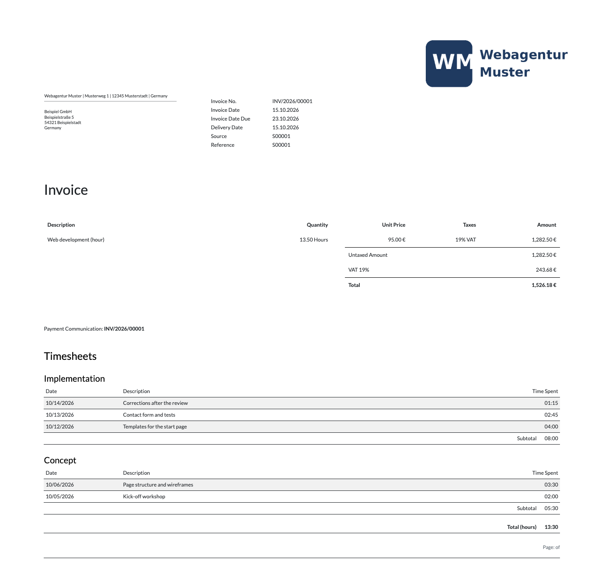

Invoice services based on timesheets from the sales order as usual. The time
entries billed by the invoice are printed whenever it is previewed, printed
or sent. The separate report *Timesheets* of the print menu stays available.

Sending the invoice by e-mail attaches the invoice with its time entries,
and nothing else about them. Odoo 20 also attaches its own report
*Timesheets* to the e-mail of an invoice that bills time entries (e-mail
template *Invoice: Sending*, field *Dynamic Reports*); this module leaves it
out, whatever is set for the customer. So the settings of this module alone
decide whether the e-mail carries time entries: for a customer, invoice or
line set to *No*, none at all.
